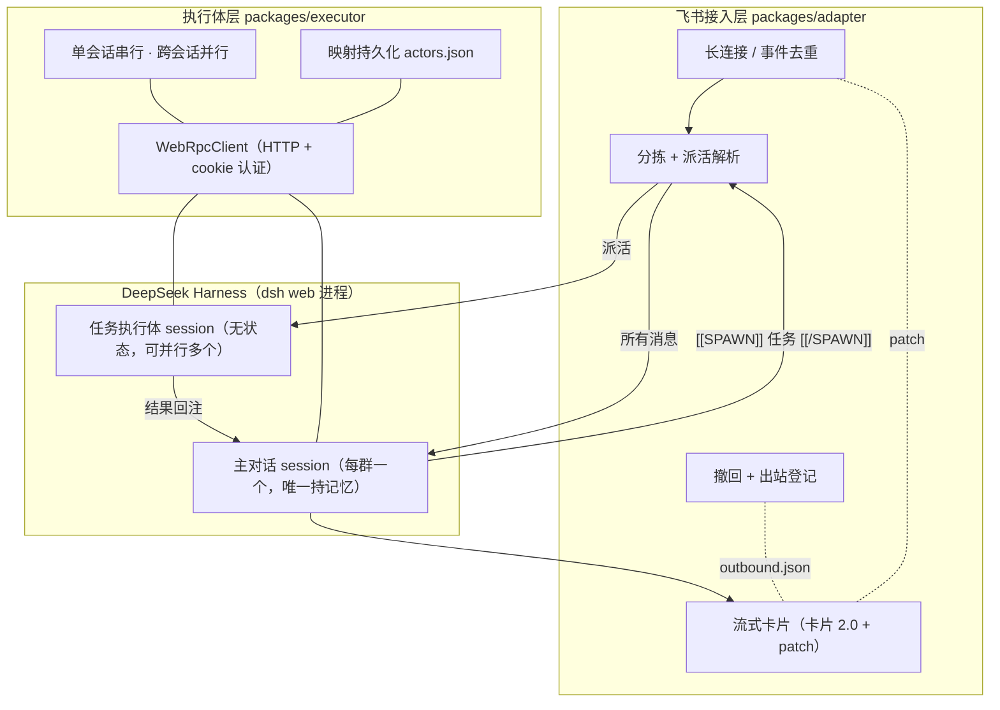

# Feishu × DeepSeek Harness Connector

把飞书群消息接进 [DeepSeek Harness](https://github.com/deepseek-ai/DeepSeek-Harness) 的独立服务：**一个主对话持记忆、负责对接，任务派给无状态执行体并行去跑**。主对话不再被长任务占死，多人同时提问也不会互相污染。

## 为什么不用现成插件

dsh 的飞书插件是「一个 chat = 一个 session」，全群共用一条队列：

- 张三跑长任务时，李四的消息排在后面干等；
- 所有人共享同一段上下文，A 的对话会污染 B；
- 主控在干重活，期间不可响应。

这套实现把「接入」和「执行」拆成两层，每个说话的人拿到独立的执行体。

## 架构



**执行体不自己起进程**：它通过 dsh web 的 HTTP API 驱动 agent，web 是 session 的唯一写者——Web 侧边栏里打开过的会话，机器人照样能继续聊（旧方案会撞 `session/writer-held` 锁）。

四个包 + 一个接线入口：

| 包 | 职责 |
|---|---|
| `packages/adapter` | 飞书接入：长连接、分拣、派活解析、流式卡片、撤回。**不碰进程与 session** |
| `packages/executor` | 执行体：`ActorKey → session`、HTTP RPC、串行队列、持久化。**不碰飞书** |
| `packages/guard` | dsh 插件：按会话前缀限制飞书来源的工具调用（只读/范围/凭证保护） |
| `packages/registrar` | dsh 插件：把飞书会话挂到工作区，让 Web 侧边栏看得见 |
| `bridge` | 接线入口（约 90 行，无业务逻辑） |

## 特性

- **主对话持记忆**：每个群一个主对话，所有消息都进它——追问不会掉进另一段上下文
- **派活并行**：主对话判断「能答就答、要干活就派」，任务甩给无状态执行体同时跑
- **并行实测**：三人同时提问 14.6 秒全部答完（串行需 43 秒）
- **流式卡片**：卡片 2.0 + 原地 patch，支持列表、代码块、表格
- **撤回**：出站消息持久化登记，重启后仍可撤；文本/文件/卡片一视同仁
- **失败可见**：模型报错、执行超时都会让卡片变红并附原因；派活链路有开始/完成/回发三段日志
- **自愈**：长连接连续 5 分钟未连通主动退出，交给 systemd 重启
- **安全**：主对话不执行命令；任务执行体可干活但路径限项目工作区 + 技能目录；凭证类文件一律拦

## 快速开始

### 1. 安装

```bash
git clone https://github.com/ZhaoBody/feishu-dsh-connector.git
cd feishu-dsh-connector
pnpm install            # 四个包共用一个 workspace
```

### 2. 建一个飞书机器人

还没建过飞书应用的话，照 **[docs/setup-feishu-app.md](docs/setup-feishu-app.md)** 走一遍：创建应用 → 开机器人能力 → 勾权限 → 事件订阅选「长连接」并订阅 `im.message.receive_v1` → 发布 → 拉进群。

### 3. 配置

```bash
cp bridge/.env.example bridge/.env
# 填 FEISHU_APP_ID / FEISHU_APP_SECRET / DSH_WORKSPACE
# 可选：FEISHU_OWNER_USERS（有完整权限的人）、FEISHU_ALLOWED_USERS（留空=所有人可用）
```

### 4. 启动

开发时直接跑：

```bash
cd bridge && pnpm start
```

生产环境请用 systemd 托管（进程独立于 dsh、崩溃自动拉起、开机自启）：见 **[docs/deploy-systemd.md](docs/deploy-systemd.md)**。

### 5. 注册会话可见性插件（可选）

飞书会话默认只存在于 `sdk` profile，dsh Web 侧边栏看不到。装上 registrar 就能看见：

```bash
plugin_manager install_bundle --target /absolute/path/to/packages/registrar
```

并在 `cordis.patch.yml` 里配置 `workspacePath`（你的飞书工作区绝对路径）。

## 安全须知

**执行体能在这台机器上读文件。** 上线前必须配置白名单：

```bash
FEISHU_ALLOWED_USERS=ou_xxx   # 非白名单用户在进 agent 之前就被拒
```

`packages/guard` 插件再按**会话类型**做工具级约束（靠 session id 前缀区分）：

| 会话 | 前缀 | 能干什么 |
|---|---|---|
| 你自己的飞书会话 | `feishu-owner-` | 全部权限 |
| 主对话（每群一个） | `feishu-` | 只判断与派活，不跑命令；读限项目工作区 |
| 任务执行体 | `feishu-task-` | 能写、能跑命令，但路径限**项目工作区 + 技能目录**；凭证类一律拦 |
| 你自己的 Web 会话 | 其他 | 完全不受影响 |

`FEISHU_ALLOWED_USERS` 留空 = 所有人可 @；`FEISHU_OWNER_USERS` 决定谁拿到完整权限。

## 开发

```bash
pnpm -r test        # adapter 43 + executor 9 + registrar 12
pnpm -r typecheck   # 三个 TS 包
```

全部测试用假进程 / 假连接，不需要真实 dsh 与飞书凭证。

## 已知限制

- 中断是**降级实现**：SDK 协议没有 agent 级 cancel，只能等回合结束或杀掉进程
- 入站只处理文本与图片；文件会落盘后把路径交给 agent
- 单轮执行默认 10 分钟超时；超时后进程仍在跑，但调用方会立刻拿到失败

## License

MIT
