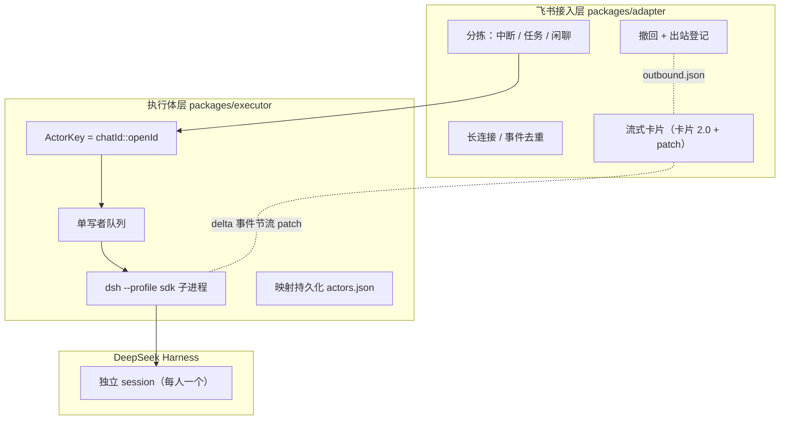

# Feishu × DeepSeek Harness Connector

把飞书群消息接进 [DeepSeek Harness](https://github.com/deepseek-ai/DeepSeek-Harness) 的独立服务：**每个群成员一个专属执行体**，各自串行、互不阻塞，机器人自己不再被长任务占死。

## 为什么不用现成插件

dsh 的飞书插件是「一个 chat = 一个 session」，全群共用一条队列：

- 张三跑长任务时，李四的消息排在后面干等；
- 所有人共享同一段上下文，A 的对话会污染 B；
- 主控在干重活，期间不可响应。

这套实现把「接入」和「执行」拆成两层，每个说话的人拿到独立的执行体。

## 架构



三个包 + 一个接线入口：

| 包 | 职责 |
|---|---|
| `packages/adapter` | 飞书接入：长连接、分拣、流式卡片、撤回。**不碰进程与 session** |
| `packages/executor` | 执行体：`ActorKey → session`、子进程、单写者队列、持久化。**不碰飞书** |
| `packages/registrar` | dsh 插件：把飞书会话挂到工作区，让 Web 侧边栏看得见 |
| `bridge` | 接线入口（约 90 行，无业务逻辑） |

## 特性

- **按人隔离**：同一群内每个成员一个独立 session，各自上下文、互不干扰
- **同人串行**：同一个人连发多条严格按序执行，不会并发写丢更新
- **跨人并行**：两个人同时跑任务，实测两个请求几乎同时返回
- **流式卡片**：卡片 2.0 + 原地 patch，支持列表、代码块、表格
- **撤回**：出站消息持久化登记，重启后仍可撤；文本/文件/卡片一视同仁
- **失败可见**：模型报错、进程崩溃、执行超时都会让卡片变红并附原因
- **自愈**：子进程崩溃自动重建；长连接失败主动退出交给 systemd 重启
- **安全**：用户白名单 + 沙箱权限模式（默认 `workspace-write`）

## 快速开始

### 1. 安装

```bash
git clone https://github.com/ZhaoBody/feishu-dsh-connector.git
cd feishu-dsh-connector
pnpm install            # 四个包共用一个 workspace
```

### 2. 建一个飞书机器人

还没建过飞书应用的话，照 **[docs/setup-feishu-app.md](docs/setup-feishu-app.md)** 走一遍：创建应用 → 开机器人能力 → 勾权限 → 事件订阅选「长连接」并订阅 `im.message.receive_v1` → 发布 → 拉进群。

### 3. 配置

```bash
cp bridge/.env.example bridge/.env
# 填 FEISHU_APP_ID / FEISHU_APP_SECRET / DSH_WORKSPACE / FEISHU_ALLOWED_USERS
```

### 4. 启动

```bash
cd bridge && pnpm start
```

### 5. 注册会话可见性插件（可选）

飞书会话默认只存在于 `sdk` profile，dsh Web 侧边栏看不到。装上 registrar 就能看见：

```bash
plugin_manager install_bundle --target /absolute/path/to/packages/registrar
```

并在 `cordis.patch.yml` 里配置 `workspacePath`（你的飞书工作区绝对路径）。

## 安全须知

**执行体能在这台机器上跑命令。** 上线前必须配置：

```bash
FEISHU_ALLOWED_USERS=ou_xxx          # 白名单，不配等于群成员都能用
DSH_PERMISSION_MODE=workspace-write  # 沙箱边界，越界写会被拒
```

SDK 运行时没有审批 UI，需要审批的操作会 **fail closed（直接拒绝）**，不会挂起。

## 开发

```bash
pnpm -r test        # adapter 43 + executor 9 + registrar 12
pnpm -r typecheck   # 三个 TS 包
```

全部测试用假进程 / 假连接，不需要真实 dsh 与飞书凭证。

## 已知限制

- 中断是**降级实现**：SDK 协议没有 agent 级 cancel，只能等回合结束或杀掉进程
- 入站只处理文本与图片；文件会落盘后把路径交给 agent
- 单轮执行默认 10 分钟超时；超时后进程仍在跑，但调用方会立刻拿到失败

## License

MIT
